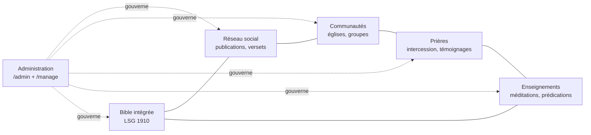

# 01 — Vue d'ensemble du projet

## En une phrase
e-Parole est l'espace numérique où des chrétiens évangéliques d'Afrique francophone **lisent la Bible, prient
les uns pour les autres et grandissent ensemble**, dans un produit pensé pour le mobile et les réseaux lents.

## Ce que le produit combine

La Bible n'est pas un module annexe : un verset peut être cité dans une publication, une prière, un enseignement
ou un message, avec sa référence et sa traduction conservées.

## Espaces

| Espace | Route | Utilisateurs | Priorité de design |
|---|---|---|---|
| Communautaire | `/` | Membres, visiteurs | Mobile-first, lecture, chaleur |
| Responsable | `/manage` | `COMMUNITY_OWNER`, `COMMUNITY_ADMIN`, `COMMUNITY_MODERATOR` | Fonctionnel, mobile possible |
| Administration | `/admin` | `SUPER_ADMIN`, `ADMIN`, `MODERATOR`, `CONTENT_EDITOR` | Desktop-first, productivité |

## Index de la documentation

| Domaine | Documents |
|---|---|
| Produit | [02 Vision](02-VISION-AND-OBJECTIVES.md) · [03 Identité](03-EVANGELICAL-IDENTITY.md) · [04 Exigences](04-PRODUCT-REQUIREMENTS.md) · [05 Personas](05-USER-PERSONAS.md) · [06 User stories](06-USER-STORIES.md) · [07 MVP](07-MVP-SCOPE.md) · [08 Roadmap](08-ROADMAP.md) |
| Technique | [09 Stack](09-TECH-STACK.md) · [10 Architecture](10-SYSTEM-ARCHITECTURE.md) · [11 Base de données](11-DATABASE-DESIGN.md) · [12 Auth](12-AUTHENTICATION.md) · [13 API](13-API-DESIGN.md) |
| Design | [14 UI/UX](14-UI-UX-GUIDELINES.md) · [15 Design system](15-DESIGN-SYSTEM.md) · [16 Composants](16-COMPONENT-LIBRARY.md) · [17 Responsive](17-RESPONSIVE-DESIGN.md) · [18 Accessibilité](18-ACCESSIBILITY.md) |
| Confiance | [19 Sécurité](19-SECURITY.md) · [20 Confidentialité et modération](20-PRIVACY-AND-MODERATION.md) |
| Qualité et exploitation | [21 Tests](21-TESTING-STRATEGY.md) · [22 Docker](22-DOCKER-SETUP.md) · [23 Déploiement](23-DEPLOYMENT.md) · [24 CI/CD](24-CI-CD.md) · [29 Performance](29-PERFORMANCE.md) · [30 Monitoring](30-MONITORING.md) |
| Équipe | [25 Standards](25-CODING-STANDARDS.md) · [26 Git](26-GIT-WORKFLOW.md) · [27 Backlog](27-BACKLOG.md) · [28 Décisions](28-ARCHITECTURAL-DECISIONS.md) |
| Modules | [Bible](bible/README.md) · [Administration](admin/ADMIN-OVERVIEW.md) · [Claude Code](claude/CLAUDE-WORKFLOWS.md) · [ADR](adr/README.md) |

## Conventions de cette documentation
- **Validé** : décision prise en Phase 0, modifiable uniquement par un nouvel ADR.
- **Hypothèse** : à confirmer (marquée ⚠️). Les questions ouvertes sont listées dans [28](28-ARCHITECTURAL-DECISIONS.md#questions-ouvertes).
- **Prévu / Implémenté** : chaque doc de module indique l'état. À ce jour, **rien n'est implémenté**.
