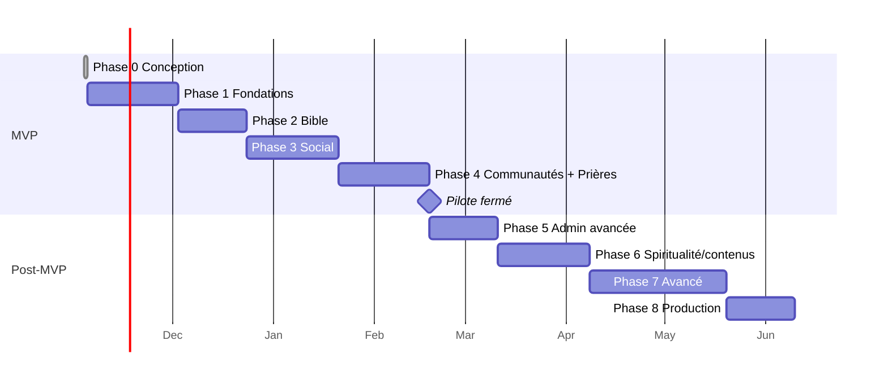

# 08 — Roadmap

Les durées sont indicatives pour **un développeur à plein temps assisté par Claude Code** ⚠️.

L'administration minimale (utilisateurs, modération, audit, verset du jour) est construite **au fil des Phases 1 à 4**,
pas en Phase 5.

---

## Phase 0 — Conception et configuration ✅
- **Livrables** : ce dossier `docs/`, ADR, `.claude/` (skills, agents, rules), audit plugins/MCP.
- **Critère** : validation écrite de l'utilisateur.

## Phase 1 — Fondations techniques
- **Dépendances** : Phase 0 validée ; questions ouvertes Q1 à Q4 tranchées.
- **Tâches** : init Next.js 16 + TS strict + pnpm ; ESLint, Prettier ; Tailwind 4 + tokens + shadcn/ui ;
  Docker Compose (Postgres, MinIO, Mailpit) ; Prisma 7 + schéma de base (User, Profile, Session, Account,
  Verification, UserRole, AuditLog, FeatureFlag, PlatformSetting, MediaAsset) ; Better Auth (email, vérification, reset,
  sessions, 2FA) ; `authorize()` + matrice de permissions ; layouts `/`, `/manage`, `/admin` ; next-intl ;
  `AppError` ; pg-boss + worker ; CI GitHub Actions ; Vitest + Playwright configurés.
- **Livrables** : on peut s'inscrire, vérifier son email, se connecter ; un SUPER_ADMIN seedé accède à `/admin` (vide mais protégé, MFA).
- **Acceptation** : CI verte ; tests de policies (100 % des permissions de la matrice) ; un MEMBER reçoit 404 sur `/admin`.
- **Risques** : compatibilité TypeScript 7 avec l'outillage (voir [09](09-TECH-STACK.md#points-de-vigilance)) ; Prisma 7 et driver adapters.

## Phase 2 — Bible intégrée
- **Tâches** : modèles Bible ; script d'import eBible.org LSG (USFX/USFM) avec checksum ; lecteur ; parseur de références ;
  FTS français + unaccent + trigrammes ; réglages de lecture ; surlignages, notes, favoris ; verset du jour + `/admin/bible/daily-verses`.
- **Acceptation** : 66 livres, 1 189 chapitres et un nombre de versets identique à celui de la source (environ 31 100 ;
  le compte exact LSG d'eBible.org sera relevé à l'import), contrôle d'intégrité par checksum ; US-1 à US-5 en E2E ;
  recherche « grace » < 150 ms p95 en local.
- **Risques** : écarts de versification entre sources ; licence (voir [bible/BIBLE-LICENSING.md](bible/BIBLE-LICENSING.md)).

## Phase 3 — Réseau social (livrée le 2026-11-06 sur `phase-3/social`, en attente de validation)
- **Tâches** : profils et visibilité ; uploads S3 (URL présignées, sharp, AVIF/WebP) ; publications typées ;
  commentaires ; réactions ; follows ; blocages ; fils (pagination par curseur) ; mentions ; favoris ;
  signalements + `/admin/moderation` v1 ; notifications in-app.
- **Acceptation** : US-10 à US-14 ; un utilisateur bloqué ne voit rien (tests d'intégration) ; images ≤ 200 Ko servies en mobile.

## Phase 4 — Communautés et prières
- **Tâches** : communautés, adhésions, invitations, rôles locaux ; `/manage` ; publications internes ;
  prières (visibilité, anonymat, soutien, témoignages) ; `/admin/users` complet ; suspension ; audit log consultable.
- **Acceptation** : US-20 à US-32, US-40, US-41, US-43 ; tests d'isolation inter-communautés ; **pilote fermé lancé**.

## Phase 5 — Administration avancée
Églises vérifiées, badges, contestations, catégories, paramètres, statistiques par période, exports autorisés,
modération de communautés par la plateforme.

## Phase 6 — Spiritualité et contenus
CMS avec workflow éditorial et révisions, méditations, enseignements, prédications (texte), plans de lecture,
import Darby et comparaison.

## Phase 7 — Fonctionnalités avancées
Messagerie (1-1 puis groupes), temps réel (voir [ADR-005](adr/ADR-005-REALTIME.md)), notifications email/push,
événements, PWA hors connexion, audio de prédication.

## Phase 8 — Production
Audit sécurité externe, audit accessibilité, tests de charge (k6), monitoring complet, WAL archiving,
plan de reprise testé, documentation d'exploitation, ouverture publique.
