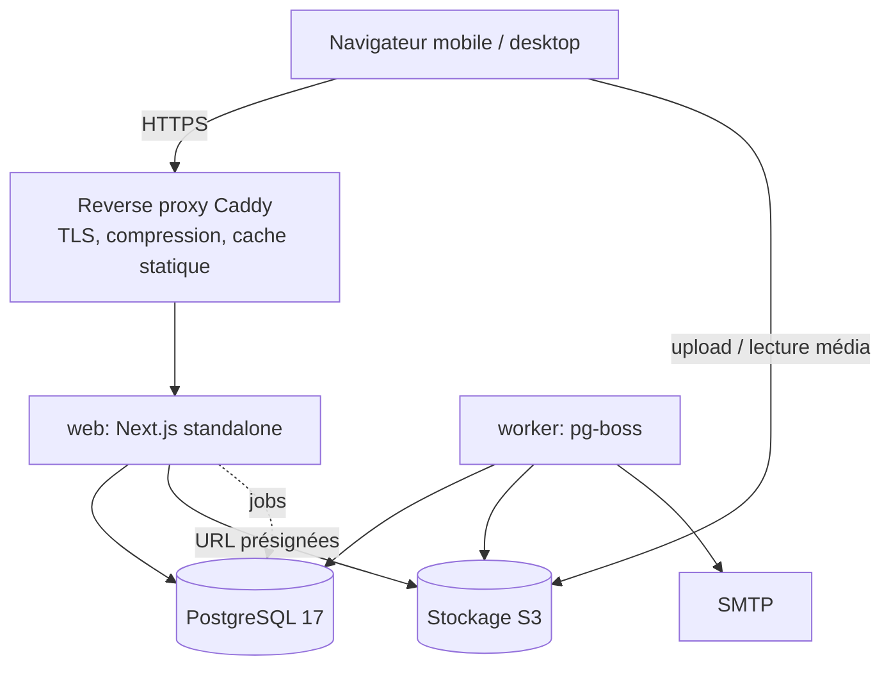
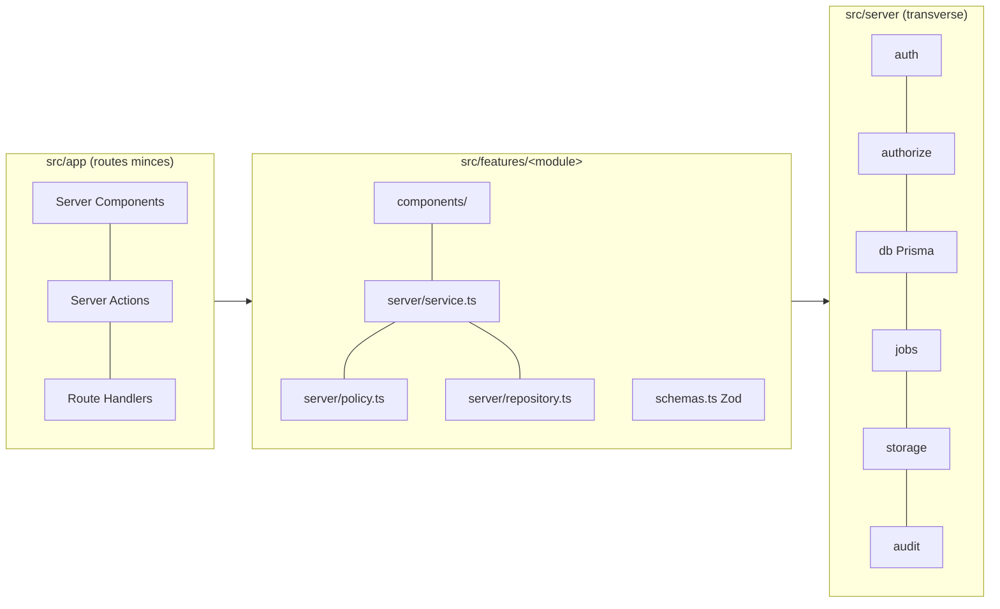
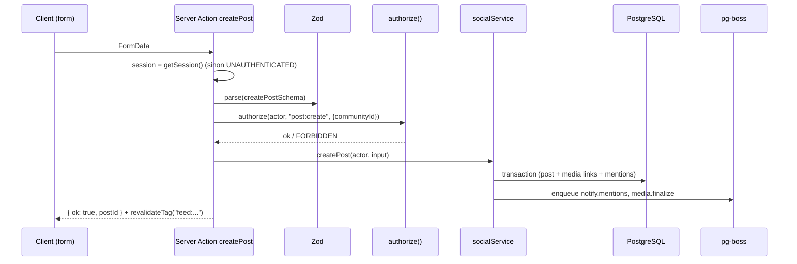

# 10 — Architecture système

Décision : **monolithe modulaire Next.js** ([ADR-001](adr/ADR-001-ARCHITECTURE.md)). Un seul dépôt, une seule base,
deux processus : `web` (Next.js) et `worker` (pg-boss).

## Vue de déploiement



## Couches internes



Règles de dépendance (vérifiées par `eslint-plugin-boundaries` ou règle `no-restricted-imports`) :
- `app` → `features` → `server` / `lib`. Jamais l'inverse.
- La logique serveur d'un module (`features/<m>/server/*`) ne s'importe que via son `index.ts` public (règle ESLint).
  Les composants (`components/`) et utilitaires purs (`lib/`) d'un module peuvent être importés par les pages.
- Prisma n'est importé que dans `src/server/db` et les `repository.ts`.

## Arborescence cible

```text
src/
  app/
    (public)/            # accueil visiteurs, à propos, CGU, pages légales
    (auth)/              # connexion, inscription, vérification, reset
    (community)/         # fil, bible, prieres, communautes, profil, notifications  → layout membre
    (manage)/manage/[communityId]/...                                          → layout responsable
    (admin)/admin/...                                                          → layout admin
    api/
      auth/[...all]/route.ts   # Better Auth
      uploads/route.ts         # URL présignées
      notifications/stream/route.ts  # SSE (Phase 3+)
  components/
    ui/        # shadcn (générés, modifiables)
    shared/    # VerseCard, Avatar, EmptyState, ReferenceLink...
    layout/    # AppShell, BottomNav, AdminSidebar, ManageSidebar
  features/
    auth/ profiles/ social/ bible/ prayers/ communities/ churches/
    editorial/ notifications/ moderation/ administration/ messaging/ events/
  server/
    auth/ db/ policies/ jobs/ storage/ audit/ rate-limit/ errors/
  lib/         # utilitaires purs (dates, slug, format), sans I/O
  i18n/        # messages fr.json, en.json
  styles/      # globals.css avec tokens
  worker.ts    # point d'entrée du worker
prisma/
  schema.prisma  migrations/  seed/
scripts/
  bible/import-usfx.ts   # import contrôlé
```

**Choix par rapport à la proposition initiale** :
- `posts`, `comments`, `reactions`, `follows`, `feed` sont regroupés dans `features/social` : ils partagent les mêmes
  règles de visibilité et de blocage ; les séparer multiplierait les dépendances croisées.
- `reading-plans` est un sous-module de `features/bible`.
- `teachings` et méditations sont dans `features/editorial` (un seul modèle de contenu, voir [11](11-DATABASE-DESIGN.md)).
- `repositories` et `policies` vivent dans chaque module, `src/server` ne contient que le transverse.

## Flux d'une mutation (exemple : publier)



## Rendu et cache
| Contenu | Stratégie |
|---|---|
| Texte biblique (chapitre) | Statique ISR / `"use cache"` avec tag `bible:<translation>`, `revalidate` infini ; invalidé à la réimport |
| Verset du jour | Cache 1 h, tag `daily-verse` |
| Fil, profils, prières | Dynamique (dépend de l'utilisateur et des blocages), pagination par curseur, `Suspense` + skeleton |
| Admin | Dynamique, jamais mis en cache partagé |

## Gestion des erreurs
`AppError(code, message, details?)` dans `src/server/errors`. Les Server Actions retournent `Result<T>` :
`{ ok: true, data } | { ok: false, error: { code, message, fieldErrors? } }`. Les erreurs inattendues sont loggées
(sans PII) et rendues par `error.tsx` avec un identifiant de corrélation.

## Internationalisation
next-intl, locale `fr` par défaut sans préfixe d'URL ; `en` ajoutée plus tard sous `/en`. Les noms de livres bibliques
viennent de la table `BibleBook` (par langue), pas des fichiers de messages.
