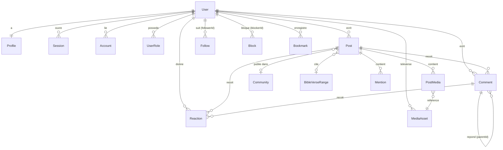
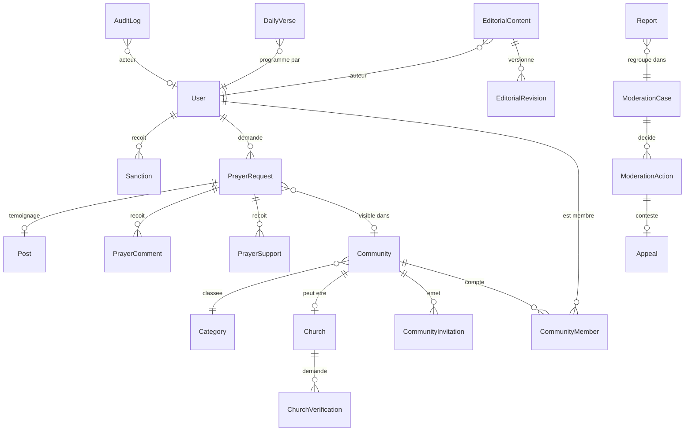

# 11 — Conception de la base de données

PostgreSQL 17 + Prisma 7 ([ADR-002](adr/ADR-002-DATABASE.md)). Ce document est la **spécification** ; le fichier
`prisma/schema.prisma` sera écrit en Phase 1 à partir d'ici. Schéma Bible détaillé :
[bible/BIBLE-DATABASE-SCHEMA.md](bible/BIBLE-DATABASE-SCHEMA.md).

## Conventions
- Ids : `String @id @default(cuid(2))` (non devinables, triables approximativement). Les tables Bible utilisent des `Int`.
- Toutes les tables : `createdAt @default(now())`, `updatedAt @updatedAt` (sauf tables d'événements immuables).
- Noms Prisma en PascalCase, tables mappées en snake_case (`@@map("prayer_request")`).
- **Soft delete** (`deletedAt`) uniquement pour : `User`, `Post`, `Comment`, `PrayerRequest`, `Community`, `EditorialContent`, `Message`.
  Les requêtes passent par les repositories qui filtrent `deletedAt IS NULL`. Purge physique par job après rétention.
- Suppression en cascade seulement pour les données possédées (ex. `PostMedia` d'un `Post`). Les références d'audit utilisent `SetNull`.
- Pagination par **curseur** (`(createdAt, id)`), jamais par offset sur les fils.
- Contraintes `CHECK` non exprimables en Prisma ajoutées en SQL brut dans les migrations (documentées dans le fichier de migration).

## Modélisation : regroupements retenus
| Proposition initiale | Modèle retenu | Raison |
|---|---|---|
| `Role`, `Permission`, `UserRole` | `UserRole` (enum `GlobalRole`) ; permissions **en code** | Matrice versionnée, testable, auditable par Git ; pas de rôles personnalisés au MVP |
| `CommunityRole` | enum `CommunityRole` sur `CommunityMember` | Un rôle par membre et par communauté |
| `Verification` | table Better Auth (tokens) | Gérée par la lib |
| `Hashtag` | `Hashtag` + `PostHashtag` | Phase 3 tardive |
| `Teaching`, méditations, sermons, articles | `EditorialContent` (enum `kind`) + `EditorialRevision` | Même workflow, même éditeur |
| `TeachingCategory` | `Category` (enum `scope`) | Catégories pour communautés, contenus, prières |
| `TeachingMedia`, `PostMedia` | `MediaAsset` + tables de liaison | Un seul pipeline d'upload |
| `ModerationCase`, `ModerationAction` | `Report` regroupés en `ModerationCase` ; `ModerationAction` | Plusieurs signalements d'un même contenu = un seul dossier |
| `PrayerTestimony` | `PrayerRequest.answeredAt` + `Post` de type `TESTIMONY` lié | Le témoignage est une publication |

## Diagramme ER — identité, social, médias



## Diagramme ER — communautés, prières, éditorial, modération



## Spécification Prisma (extrait normatif)

Notation **compacte** : plusieurs champs par ligne et relations omises pour la lisibilité. Ce bloc n'est pas compilable
tel quel ; il fixe les champs, types, valeurs par défaut, contraintes et index à reproduire dans `schema.prisma`.

```prisma
enum GlobalRole { SUPER_ADMIN ADMIN MODERATOR CONTENT_EDITOR }   // MEMBER = absence de UserRole
enum CommunityRole { OWNER ADMIN MODERATOR MEMBER }
enum MembershipStatus { PENDING ACTIVE BANNED LEFT }
enum Visibility { PUBLIC FOLLOWERS COMMUNITY PRIVATE }
enum PostType { TEXT VERSE TESTIMONY MEDITATION TEACHING QUESTION PRAYER_SHARE ANNOUNCEMENT }
enum ReactionKind { AMEN LOVE ENCOURAGED }
enum AccountStatus { ACTIVE SUSPENDED BANNED PENDING_DELETION }
enum ContentStatus { DRAFT IN_REVIEW APPROVED SCHEDULED PUBLISHED REJECTED ARCHIVED }
enum EditorialKind { MEDITATION TEACHING SERMON ARTICLE ANNOUNCEMENT }
enum ReportTarget { POST COMMENT PRAYER PRAYER_COMMENT PROFILE COMMUNITY MESSAGE EDITORIAL }
enum ReportReason { SPAM HARASSMENT HATE FRAUD_FINANCIAL IMPERSONATION DANGEROUS_LINK SEXUAL SELF_HARM MINOR_SAFETY OTHER }
enum CaseStatus { OPEN IN_PROGRESS RESOLVED DISMISSED }
enum ModerationDecision { DISMISS WARN HIDE REMOVE SUSPEND BAN RESTORE }

model User {
  id            String        @id @default(cuid(2))
  email         String        @unique
  emailVerified Boolean       @default(false)
  name          String                          // requis par Better Auth ; = displayName initial
  status        AccountStatus @default(ACTIVE)
  birthYear     Int?                            // minimisation : année seulement, pour la protection des mineurs
  locale        String        @default("fr")
  twoFactorEnabled Boolean    @default(false)
  createdAt DateTime @default(now())  updatedAt DateTime @updatedAt  deletedAt DateTime?
  profile Profile?  roles UserRole[]  sessions Session[]  accounts Account[]
}

model Profile {
  userId       String  @id
  handle       String  @unique                  // citext en SQL, ^[a-z0-9_]{3,30}$
  displayName  String
  bio          String? @db.VarChar(280)
  avatarId     String? bannerId String?
  churchName   String?  churchVisibility   Visibility @default(PRIVATE)
  city         String?  locationVisibility Visibility @default(PRIVATE)
  denomination String?  denominationVisibility Visibility @default(PRIVATE)
  isDiscoverable Boolean @default(true)         // false par défaut pour les mineurs
  verifiedBadge  VerifiedBadge?                 // PASTOR | CHURCH_LEADER | BIBLE_TEACHER — aucune permission
}

model UserRole {
  userId String  role GlobalRole  grantedById String?  grantedAt DateTime @default(now())
  @@id([userId, role])
}

model Post {
  id String @id @default(cuid(2))
  authorId String  communityId String?
  type PostType @default(TEXT)
  body String @db.VarChar(5000)
  visibility Visibility @default(PUBLIC)        // COMMUNITY exige communityId (CHECK)
  verseRef  Json?                               // { translation, bookId, chapter, from, to } ; texte rendu depuis BibleVerse
  isHidden Boolean @default(false)              // masqué par modération
  commentsLocked Boolean @default(false)
  createdAt DateTime @default(now())  updatedAt DateTime @updatedAt  deletedAt DateTime?
  @@index([authorId, createdAt(sort: Desc)])
  @@index([communityId, createdAt(sort: Desc)])
  @@index([visibility, createdAt(sort: Desc)])
}

model Reaction {
  id String @id @default(cuid(2))
  userId String  postId String?  commentId String?
  kind ReactionKind
  @@unique([userId, postId])  @@unique([userId, commentId])
  // CHECK (num_nonnulls(post_id, comment_id) = 1)
}

model Follow { followerId String  followingId String  createdAt DateTime @default(now())  @@id([followerId, followingId]) @@index([followingId]) }
model Block  { blockerId  String  blockedId   String  createdAt DateTime @default(now())  @@id([blockerId, blockedId])   @@index([blockedId]) }

model Community {
  id String @id @default(cuid(2))
  slug String @unique  name String  description String?
  categoryId String  isPrivate Boolean @default(false)
  joinPolicy JoinPolicy @default(OPEN)          // OPEN | REQUEST | INVITE_ONLY
  rules String?  avatarId String?  bannerId String?
  status CommunityStatus @default(ACTIVE)       // ACTIVE | SUSPENDED
  memberCount Int @default(0)                   // dénormalisé, mis à jour en transaction
  createdAt DateTime @default(now())  updatedAt DateTime @updatedAt  deletedAt DateTime?
}

model CommunityMember {
  communityId String  userId String
  role CommunityRole @default(MEMBER)
  status MembershipStatus @default(PENDING)
  joinedAt DateTime?
  @@id([communityId, userId])
  @@index([userId, status])
  // index partiel unique : un seul OWNER actif par communauté
}

model PrayerRequest {
  id String @id @default(cuid(2))
  authorId String  communityId String?
  categoryId String
  title String @db.VarChar(120)  body String @db.VarChar(3000)
  visibility Visibility @default(PRIVATE)       // PRIVATE = l'auteur seul (journal de prière)
  isAnonymous Boolean @default(false)           // identité masquée pour tous sauf l'auteur
  commentsEnabled Boolean @default(true)
  supportCount Int @default(0)
  answeredAt DateTime?  testimonyPostId String? @unique
  archivedAt DateTime?
  createdAt DateTime @default(now())  updatedAt DateTime @updatedAt  deletedAt DateTime?
  @@index([communityId, createdAt(sort: Desc)])
  @@index([visibility, createdAt(sort: Desc)])
}
model PrayerSupport { prayerId String  userId String  createdAt DateTime @default(now())  @@id([prayerId, userId]) }

model EditorialContent {
  id String @id @default(cuid(2))
  kind EditorialKind  status ContentStatus @default(DRAFT)
  slug String @unique  title String  excerpt String?
  body Json                                     // document structuré (blocs), rendu sans HTML brut
  bibleRefs Json                                // [{ bookId, chapter, from, to }]
  authorId String  communityId String?          // contenu d'une communauté (Phase 6)
  publishAt DateTime?  publishedAt DateTime?
  currentRevisionId String?
  @@index([kind, status, publishedAt(sort: Desc)])
}

model Report {
  id String @id @default(cuid(2))
  reporterId String  targetType ReportTarget  targetId String
  reason ReportReason  details String? @db.VarChar(1000)
  evidenceSnapshot Json?                        // copie figée du contenu signalé (seule voie d'accès modérateur aux messages privés)
  caseId String
  createdAt DateTime @default(now())
  @@unique([reporterId, targetType, targetId])  // un signalement par personne et par cible
}

model ModerationCase {
  id String @id @default(cuid(2))
  targetType ReportTarget  targetId String  communityId String?
  status CaseStatus @default(OPEN)  priority Int @default(2)   // 0 critique … 3 faible
  assigneeId String?  reportCount Int @default(1)
  @@unique([targetType, targetId, status])      // un dossier ouvert par cible (index partiel en SQL)
  @@index([status, priority, createdAt])
}

model AuditLog {
  id String @id @default(cuid(2))
  actorId String?  actorRole String?
  action String                                 // "user.suspend", "role.grant", "bible.import"...
  targetType String  targetId String?
  metadata Json                                 // jamais de contenu de prière ou de message
  ip String?  userAgent String?                 // ip tronquée /24 après 90 jours
  createdAt DateTime @default(now())
  @@index([targetType, targetId])  @@index([actorId, createdAt])  @@index([action, createdAt])
}
```

Les modèles non détaillés ici (`Session`, `Account`, `Verification`, `TwoFactor` de Better Auth ; `Comment`, `Bookmark`,
`Mention`, `PostMedia`, `MediaAsset`, `CommunityInvitation`, `Church`, `ChurchVerification`, `Category`, `PrayerComment`,
`EditorialRevision`, `ModerationAction`, `Sanction`, `Appeal`, `Notification`, `NotificationPreference`,
`PlatformSetting`, `FeatureFlag`, `Conversation`, `ConversationMember`, `Message`, `Event`, `EventAttendee`) suivent
les mêmes conventions et seront spécifiés dans la PR de la phase qui les introduit.

## Implémenté en Phase 3 (migration `20261106090000_social_network`)
Modèles : `Post`, `PostMedia`, `Comment`, `Reaction`, `Follow`, `Block`, `Mute`, `PostBookmark`, `Mention`, `Notification`,
`NotificationActor`, `NotificationPreference`, `ModerationCase`, `Report`, `ModerationAction`, `Sanction` ; champs ajoutés à
`Profile` (`country`, `countryVisibility`, `handleChangedAt`, liens avatar et bannière), `MediaAsset` (`variants`,
`dominantColor`, `errorCode`, état `PROCESSING`) et `User` (`suspendedUntil`). Écarts à la spécification ci-dessus :

| Spécification | Implémenté | Raison |
|---|---|---|
| `Post.visibility` (+ `communityId`) | **Supprimé** : toute publication est publique (décision du 2026-11-05) | Une colonne à valeur unique serait du poids mort ; la visibilité Communauté sera ajoutée en Phase 4 par migration additive si elle est retenue ([ADR-011](adr/ADR-011-SOCIAL-FEEDS-VISIBILITY.md)) |
| `Post.verseRef Json` | Colonnes typées `verseTranslationId`, `verseBookId`, `verseChapter`, `verseStart`, `verseEnd` (CHECK tout ou rien, 30 versets au plus) | Clés étrangères vers la Bible, validation SQL, comme `DailyVerse` |
| `PostType` (8 valeurs) | 5 valeurs : `TEXT`, `TESTIMONY`, `QUESTION`, `MEDITATION`, `ANNOUNCEMENT` (REQ-SOC-1) | Ne rien anticiper ; `ALTER TYPE … ADD VALUE` le moment venu |
| `Bookmark` | `PostBookmark` (`post_bookmark`) | `BibleBookmark` existe déjà |
| `ReportTarget` (8 valeurs) | `POST`, `COMMENT`, `PROFILE` | Les autres cibles arrivent avec leur module |
| `ModerationDecision.RESTORE` | Non créé | Contestations en Phase 5 |
| Compteurs | `amenCount`, `loveCount`, `encouragedCount`, `commentCount`, `replyCount`, incrémentés en transaction | Une réaction par personne et par cible : verrou consultatif par (personne, cible) |

SQL brut de la migration : visibilité des champs de profil limitée à PUBLIC / FOLLOWERS / PRIVATE ; mineurs existants rendus
non découvrables ; index partiels du fil (`deletedAt IS NULL AND NOT isHidden`) ; trigger « un seul niveau de réponse » ;
`num_nonnulls` pour les cibles de réaction et de mention ; relations jamais envers soi-même ; un groupe de notification non lu
par clé ; un dossier de modération ouvert par cible ; `moderation_action` en append-only pour le rôle applicatif.

## Isolation entre communautés
1. Toute table « interne » porte `communityId` (Post, PrayerRequest, Event, EditorialContent communautaire, ModerationCase).
2. Les repositories exposent des fonctions **qui exigent** un `CommunityScope` obtenu via `requireCommunityRole()` :
   `listCommunityPosts(scope, cursor)` ; impossible d'appeler sans scope (typage).
3. Tests d'intégration dédiés : un responsable de A ne lit, ne modère, ni n'exporte rien de B.
4. ⚠️ Row Level Security PostgreSQL : étudiée, **non retenue au MVP** (complexité avec un pool Prisma). Réévaluée en Phase 8.

## Recherche
- Bible : colonne `tsvector` générée (`french_unaccent`) + index GIN ; `pg_trgm` pour les suggestions de livres
  ([bible/BIBLE-SEARCH.md](bible/BIBLE-SEARCH.md)).
- Utilisateurs / communautés : `pg_trgm` sur `handle`, `displayName`, `name`.
- Publications : FTS en Phase 5 si le besoin est confirmé.

## Migrations
- `prisma migrate dev` en local, `prisma migrate deploy` en CI/CD. Jamais `db push` hors prototype local.
- Migrations additives d'abord (expand → migrate data → contract) pour éviter les interruptions.
- Toute migration touchant `bible_*` est revue par `bible-integration-expert`.

## Sauvegarde, restauration, rétention
| Donnée | Rétention |
|---|---|
| Comptes supprimés | Soft delete 30 jours (annulable), puis anonymisation/purge |
| Prières archivées | Conservées jusqu'à suppression par l'auteur ; purge physique 30 jours après suppression |
| Sessions expirées | Purge quotidienne |
| Audit log | 2 ans, IP tronquées après 90 jours |
| Publications et commentaires supprimés par leur auteur | 1 mois, puis purge physique avec leurs images (décision du propriétaire, 2026-11-06 ; job à livrer, backlog R-4) |
| Signalements résolus | 1 an, puis `evidenceSnapshot` effacé |
| Sauvegardes | Quotidiennes 14 j, hebdomadaires 8 semaines, chiffrées, hors site |

Procédures : [22-DOCKER-SETUP.md](22-DOCKER-SETUP.md#sauvegardes-et-restauration) et [23-DEPLOYMENT.md](23-DEPLOYMENT.md).
