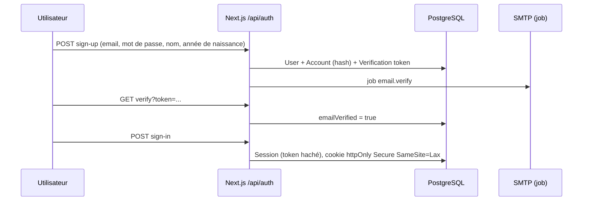

# 12 — Authentification et sessions

Décision : **Better Auth 1.7.x** ([ADR-003](adr/ADR-003-AUTHENTICATION.md)).

## Comparaison
| Critère | Better Auth 1.7 | Auth.js (next-auth) |
|---|---|---|
| Statut de la version adaptée à Next 16 | **Stable** | v5 toujours `beta` (5.0.0-beta.32) ; v4 stable mais conçue pour l'ancien modèle |
| Email + mot de passe | Natif (hash scrypt, reset, vérification) | Credentials provider découragé, à coder soi-même |
| 2FA TOTP + codes de secours | Plugin `twoFactor` | À implémenter |
| Sessions en base, liste et révocation | Natif | Possible (adapter), moins outillé |
| Rate limiting des endpoints auth | Intégré (stockage DB possible) | À ajouter |
| Adapter Prisma | Oui | Oui |
| Plugins utiles | `admin`, `organization`, `username`, `haveIBeenPwned` | Écosystème OAuth riche |

Better Auth gagne sur les exigences MVP (email/mot de passe, MFA admin, sessions). On **n'utilise pas** son plugin
`organization` pour les communautés : nos rôles locaux et règles d'isolation sont métier et doivent rester dans
`features/communities`. Le plugin `admin` n'est pas utilisé non plus : nos rôles globaux sont gérés par `UserRole` + `authorize()`.

## Flux



## Règles
- Mot de passe : 10 caractères minimum, vérification contre les fuites connues (plugin `haveIBeenPwned`, k-anonymat) ⚠️ appel réseau externe à valider.
- Cookie de session `__Secure-` en production, `httpOnly`, `SameSite=Lax`. Durée 30 jours glissants pour membres,
  **12 heures** pour toute session portant un rôle global, avec ré-authentification (« sudo mode », 10 min) avant action sensible.
- **MFA obligatoire** pour `SUPER_ADMIN`, `ADMIN`, `MODERATOR`, `CONTENT_EDITOR` : l'accès à `/admin` est refusé tant que la 2FA n'est pas activée.
- Email non vérifié : lecture autorisée, écriture (publier, commenter, prier, rejoindre) refusée.
- Limites : 5 tentatives de connexion / 15 min / IP+email ; 3 demandes de reset / heure / email.
- Les messages d'erreur ne révèlent pas l'existence d'un compte (« Si un compte existe, un email a été envoyé »).
- Suspension : toutes les sessions sont révoquées ; la connexion affiche le motif et la voie de contestation.
- Suppression de compte : statut `PENDING_DELETION`, sessions révoquées, restauration possible 30 jours, puis job d'anonymisation.

## Implémenté en Phase 1 (écarts)
- `autoSignIn: false` à l'inscription (anti-énumération) ; le lien de vérification connecte l'utilisateur.
- Pas de vérification HaveIBeenPwned (appel réseau externe non validé) ⚠️ à décider.
- Pas d'« appareil de confiance » pour la 2FA.
- Session admin : 12 h depuis la connexion, second facteur vérifié pour la session (`mfaVerifiedAt`),
  ré-authentification par mot de passe < 10 min pour les permissions de `REAUTH_PERMISSIONS`.

## Accès dans le code
```ts
// src/server/auth/session.ts
export async function requireActor(): Promise<Actor>   // UNAUTHENTICATED sinon
export async function requireVerifiedActor(): Promise<Actor>
export async function requireAdminActor(): Promise<AdminActor> // rôle global + 2FA + session récente
```
`Actor = { userId, globalRoles, status, emailVerified, isMinor }`, chargé une fois par requête (`cache()` de React).

## Futur
Connexion Google (Phase 5) ; OTP SMS (coût à étudier, fort usage du téléphone en Afrique de l'Ouest) ; passkeys.
