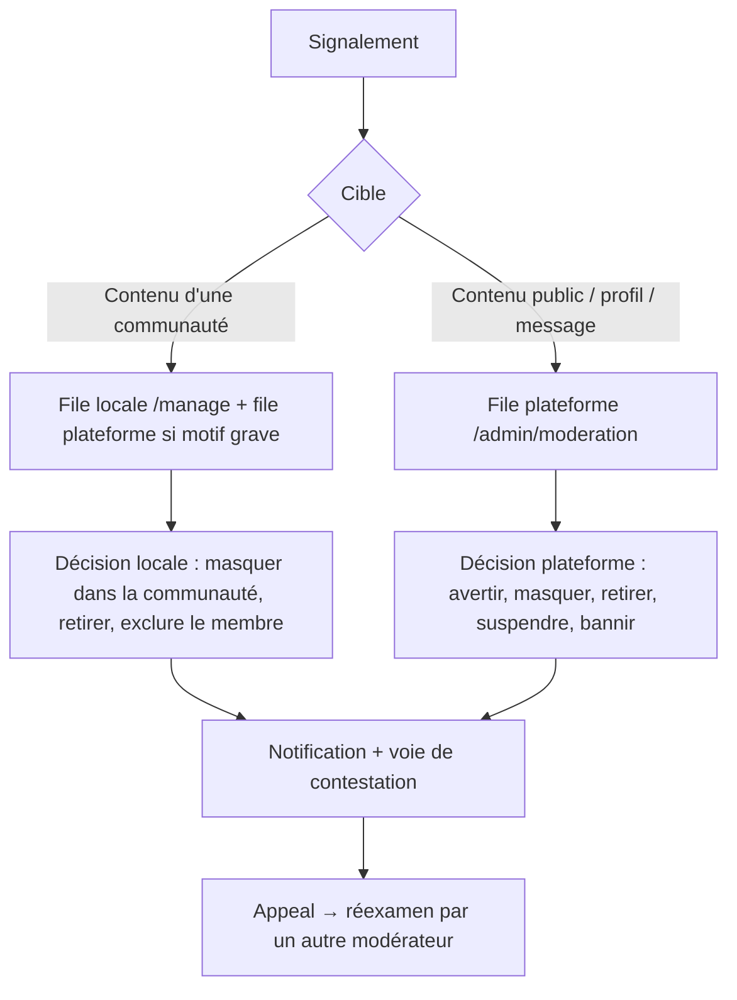

# 20 — Confidentialité et modération

## Principes
1. **Privé par défaut** pour l'intime : demandes de prière créées en « Privé » sauf choix contraire explicite,
   champs d'église/localisation masqués par défaut.
2. **Pas d'accès humain arbitraire** : aucun rôle (même `SUPER_ADMIN`) n'a d'écran pour lire une prière privée, une
   note biblique ou un message privé. L'accès en base est réservé aux opérations techniques, journalisé et exceptionnel.
3. **Signalement = consentement d'accès limité** : quand un participant signale un message, une copie figée
   (`evidenceSnapshot`) du message signalé et des 5 précédents de la même conversation est jointe au dossier. Le modérateur
   ne voit que cela.
4. **Transparence** : chaque sanction est notifiée avec motif et voie de contestation.

## Visibilité des demandes de prière
| Visibilité | Qui voit | Commentaires | Partage |
|---|---|---|---|
| `PRIVATE` | L'auteur seul (journal de prière) | Non | Non |
| `COMMUNITY` | Membres actifs de la communauté choisie | Membres | Non |
| `FOLLOWERS` | Abonnés de l'auteur | Abonnés | Non |
| `PUBLIC` | Tout utilisateur connecté (jamais indexé par les moteurs, jamais visible déconnecté) | Connectés | Oui si l'auteur l'autorise |

Anonymat : l'auteur apparaît comme « Un membre » / « Une personne » ; le lien auteur n'est pas envoyé au client, même aux
responsables de la communauté. Les modérateurs plateforme le voient uniquement si la demande est signalée.
Les demandes `PUBLIC` contenant des mots sensibles (maladie, violence, suicide…) déclenchent une suggestion
« Veux-tu limiter la visibilité ? » avant publication. Aucune promesse de guérison ou de résultat n'est produite par l'interface.

**Signaux de détresse** : une demande mentionnant le suicide ou l'automutilation affiche à l'auteur des ressources d'aide
locales ⚠️ (numéros à collecter par pays) et crée un dossier de modération priorité 0.

## Mineurs
- Âge minimum : **13 ans** ⚠️ (à valider juridiquement). Année de naissance demandée à l'inscription.
- Moins de 18 ans : profil non découvrable par défaut, messagerie limitée aux abonnés mutuels, prières `PUBLIC` désactivées,
  pas de géolocalisation, contenus signalés traités en priorité 1, interdiction d'envoi de messages par des adultes non abonnés mutuels.

## Modération : niveaux

Motifs graves remontant toujours à la plateforme : `FRAUD_FINANCIAL`, `IMPERSONATION`, `MINOR_SAFETY`, `SELF_HARM`, `HATE`.

## Priorités
| Priorité | Motifs | Objectif de traitement |
|---|---|---|
| 0 critique | `SELF_HARM`, `MINOR_SAFETY` | 4 h |
| 1 haute | `FRAUD_FINANCIAL`, `IMPERSONATION`, `HARASSMENT`, `HATE` | 24 h |
| 2 normale | `SPAM`, `DANGEROUS_LINK`, `SEXUAL` | 48 h |
| 3 faible | `OTHER` | 72 h |

Escalade automatique : un contenu atteignant 5 signalements distincts de comptes de plus de 7 jours est masqué
provisoirement en attendant la décision.

## Échelle de sanctions
Avertissement → retrait de contenu → restriction temporaire (publication/commentaires 24 h à 7 j) → suspension (7 à 30 j) →
bannissement. La fraude financière avérée et l'atteinte aux mineurs peuvent mener directement au bannissement.

## Droits des personnes
Export JSON en libre-service, suppression (30 j de grâce), rectification via le profil, retrait de consentement
(suppression des champs sensibles). Politique de confidentialité et CGU à rédiger avec un juriste avant le pilote.
