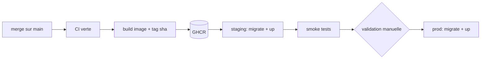

# 23 — Déploiement

**Statut : spécification.** Aucun déploiement en Phase 0.

## Cible du pilote (coût maîtrisé)
| Composant | Choix proposé ⚠️ | Coût indicatif |
|---|---|---|
| Serveur | 1 VPS 4 vCPU / 8 Go / 160 Go NVMe (Hetzner, OVH ou Scaleway) | 10 à 25 €/mois |
| Reverse proxy + TLS | Caddy (certificats automatiques) | 0 |
| Base | PostgreSQL 17 en conteneur sur le VPS, volume dédié | inclus |
| Stockage objet | S3 managé (Cloudflare R2 sans frais de sortie, ou Scaleway/OVH Object Storage) | 0 à 10 €/mois |
| Email | SMTP transactionnel (Brevo, Postmark…) | 0 à 15 €/mois |
| Sauvegardes | Bucket séparé, autre fournisseur ou autre région | < 5 €/mois |

Pourquoi pas Vercel : coûts imprévisibles à l'échelle, worker et base à héberger ailleurs, données hors contrôle.
Pourquoi pas Kubernetes : complexité injustifiée pour un pilote.

## Latence Afrique de l'Ouest
Les VPS européens donnent ~80 à 150 ms depuis Ouagadougou ⚠️ à mesurer. Le texte biblique et les assets statiques sont
mis en cache CDN (Cloudflare ou Bunny) ; les pages dynamiques sont légères. Hébergement local (Burkina, Côte d'Ivoire,
Sénégal) à réévaluer en Phase 8 selon l'offre et les exigences juridiques.

## Processus

- Déploiement **toujours manuel** (approbation GitHub Environment), jamais automatique vers la production.
- Migrations compatibles avec la version précédente (expand/contract) pour permettre le rollback de l'image.
- Rollback : redéployer le tag précédent ; les migrations ne sont pas annulées automatiquement.

## Checklist de mise en production (Phase 8)
Secrets générés et stockés hors dépôt · MFA activée sur tous les comptes admin · sauvegarde + restauration testées ·
monitoring et alertes actifs · CSP vérifiée · politique de confidentialité et CGU publiées · procédure d'incident écrite.
