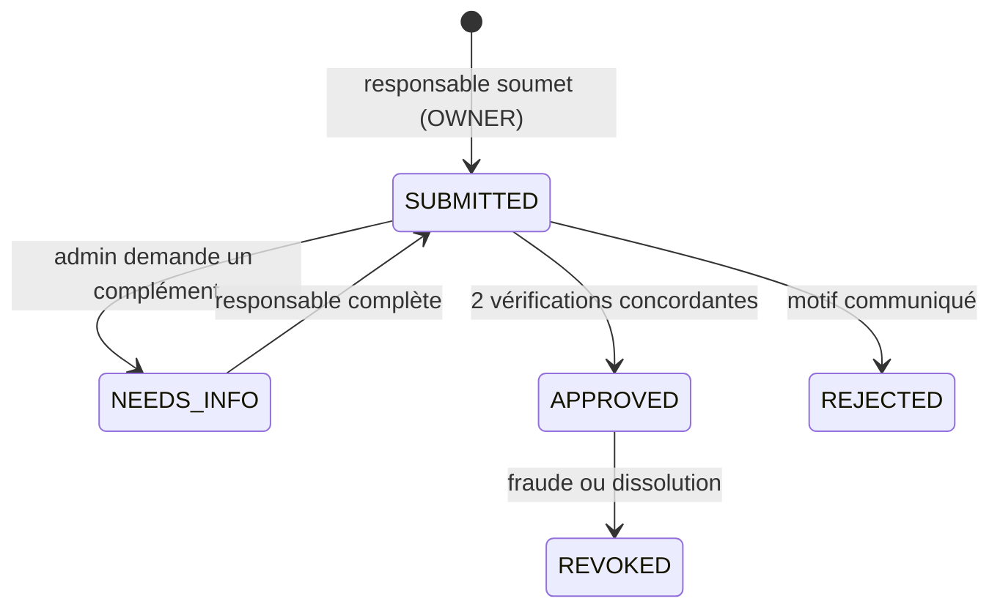

# Églises et vérifications — `/admin/churches` (Phase 5)

## Objectif
Lutter contre l'usurpation (faux pasteurs, fausses églises sollicitant de l'argent) en offrant un badge
« Église vérifiée » et des badges de responsables, attribués par un processus humain.

## Modèle
`Church` (1-1 optionnel avec `Community`) : nom officiel, dénomination/fédération (texte libre + liste indicative :
Assemblées de Dieu, Église Protestante Baptiste, CMA, Église de Pentecôte, Fédération des Églises et Missions
Évangéliques du Burkina…), ville, pays, adresse, contact public.
`ChurchVerification` : demandeur, pièces (stockées dans le bucket **privé**), statut (`SUBMITTED`, `NEEDS_INFO`,
`APPROVED`, `REJECTED`, `REVOKED`), décideur, motifs, dates.

## Processus

Pièces possibles ⚠️ à définir avec l'équipe : attestation de la fédération, récépissé de reconnaissance d'association
cultuelle, lettre signée du conseil, appel vidéo. Les pièces sont supprimées 90 jours après la décision (seule la décision est conservée).

## Badges individuels
`PASTOR`, `CHURCH_LEADER`, `BIBLE_TEACHER` : demandés depuis le profil, idéalement rattachés à une église vérifiée,
même processus simplifié. **Aucune permission associée.**

## Protection contre l'usurpation
- Liste de noms protégés (églises vérifiées, pasteurs vérifiés) : alerte si un nouveau compte ou une nouvelle communauté
  utilise un nom très proche (trigrammes).
- Signalement `IMPERSONATION` en priorité 1.
