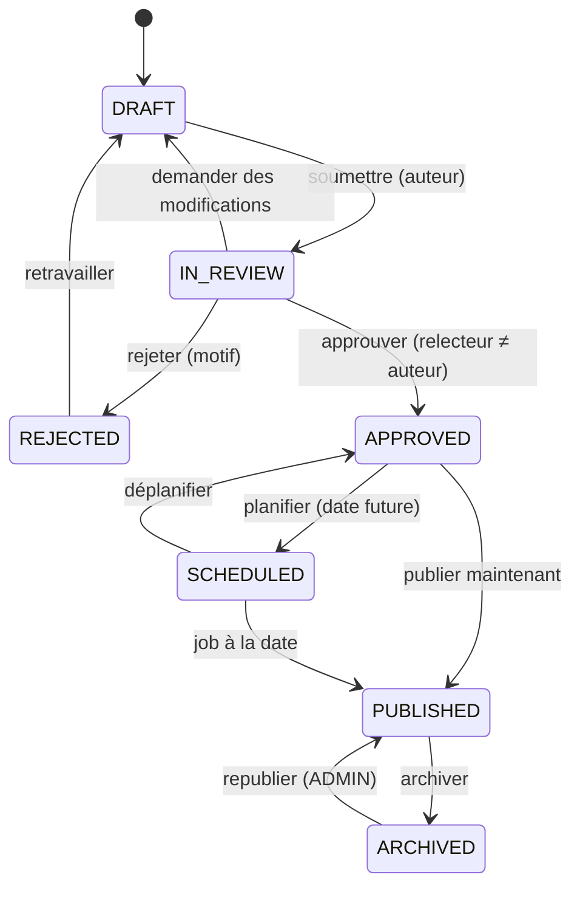

# CMS éditorial — `/admin/content` (Phase 6 ; verset du jour au MVP)

## Contenus
Un seul modèle `EditorialContent` avec `kind` : `MEDITATION`, `TEACHING`, `SERMON`, `ARTICLE`, `ANNOUNCEMENT`.
Les versets du jour et plans de lecture ont leurs propres tables mais **le même workflow**.

## Workflow

| Transition | Qui |
|---|---|
| Créer, éditer son brouillon, soumettre | `CONTENT_EDITOR`, `ADMIN`, `SUPER_ADMIN` |
| Approuver / rejeter | `CONTENT_EDITOR` (pas son propre contenu), `ADMIN`+ |
| Planifier / publier | `ADMIN`+, ou `CONTENT_EDITOR` avec `canPublish` |
| Archiver | `ADMIN`+ |

Toute modification d'un contenu publié crée une révision et repasse en `IN_REVIEW` (la version publiée reste en ligne
jusqu'à l'approbation de la nouvelle).

## Contenus de communauté
Décision Q8 : les responsables de communauté rédigent aussi des contenus éditoriaux (méditations, enseignements,
prédications, annonces) **pour leur communauté**, depuis `/manage/[communityId]/content`.

| Aspect | Contenu plateforme | Contenu de communauté |
|---|---|---|
| Auteurs | `CONTENT_EDITOR`, `ADMIN`, `SUPER_ADMIN` | `COMMUNITY_OWNER`, `COMMUNITY_ADMIN` |
| Stockage | `EditorialContent.communityId = null` | `EditorialContent.communityId = <id>` |
| Workflow | Complet (relecture par une autre personne) | Simplifié : `DRAFT` → `SCHEDULED` / `PUBLISHED` → `ARCHIVED` ; relecture facultative par un autre admin local |
| Visibilité | Toute la plateforme | Selon la communauté (privée : membres seulement) |
| Mise en avant globale | Oui | Non. Un admin plateforme peut **reprendre** un contenu de communauté publique dans la sélection globale, avec l'accord de la communauté |
| Contrôle | Équipe éditoriale | Modération : signalement possible, file locale + file plateforme pour les motifs graves |

Le verset du jour reste **unique et géré par la plateforme**. Le même éditeur, les mêmes blocs et la même séparation
texte biblique / commentaire s'appliquent dans les deux cas.

## Éditeur
Éditeur de blocs structuré (paragraphe, titre, citation biblique `VerseQuote`, liste, image, encadré). Stocké en JSON,
rendu par des composants React (pas de HTML brut). ⚠️ Choix de la bibliothèque (Tiptap, Lexical, ou éditeur maison
minimal) à trancher en Phase 6 selon licence et poids.
Insertion de référence biblique : le bloc stocke la référence, le texte est rendu depuis la base.

## Champs
Titre, slug, extrait, corps, références bibliques, catégorie, tags, auteur (affiché), église associée (optionnelle),
image de couverture, médias autorisés (audio/vidéo en Phase 7), date de publication.

## Révisions
`EditorialRevision` : snapshot complet, auteur, date, note de révision ; diff visuel entre révisions ; restauration
d'une révision = nouvelle révision.

## Séparation des genres
Le rendu distingue visuellement **le texte biblique** (police serif, filet or, attribution) **du commentaire** (style
éditorial normal, auteur affiché). Mention « Méditation de … » ou « Enseignement de … » obligatoire.
