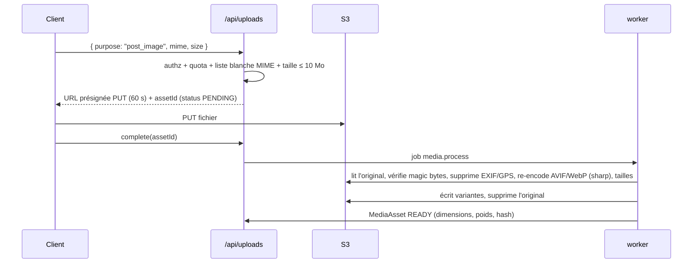

# ADR-004 — Stockage objet S3 compatible

- **Statut** : Accepté (Phase 0)
- **Date** : 2026-11-04

## Contexte
Avatars, bannières, images de publications et de communautés, pièces de vérification d'église ; plus tard audio/vidéo.
Interdiction de stocker les fichiers volumineux dans PostgreSQL.

## Décision
- Code écrit contre l'**API S3** via `@aws-sdk/client-s3` + `@aws-sdk/s3-request-presigner`, pour rester portable.
- **Dev** : MinIO en conteneur. ⚠️ En 2025, MinIO a fortement réduit son édition communautaire (console, distribution
  binaire) ; acceptable en dev, **déconseillé en production auto-hébergée**.
- **Production** : S3 managé (Cloudflare R2 pour l'absence de frais de sortie, ou Scaleway/OVH Object Storage).
  Alternatives auto-hébergées si nécessaire : Garage, SeaweedFS.
- Deux buckets : `public` (médias publics servis via CDN, noms aléatoires) et `private` (pièces de vérification, médias de
  communautés privées ; accès par URL présignées de 5 min).

## Flux d'upload

## Conséquences
- PostgreSQL stocke `MediaAsset { ownerId, purpose, bucket, key, mime, size, width, height, sha256, status, visibility }`.
- Job quotidien de nettoyage des assets `PENDING` > 24 h ou non référencés > 7 jours.
- Formats acceptés au MVP : JPEG, PNG, WebP, HEIC (converti). SVG et GIF animés refusés.
- Sauvegarde du bucket via réplication vers un autre fournisseur.
