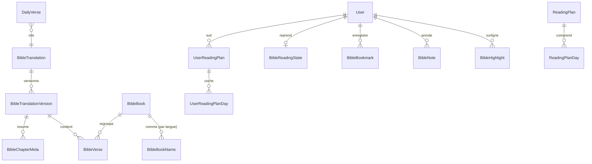

# Schéma de données Bible

## Diagramme



`BibleChapter` n'est pas une table : un chapitre = `(versionId, bookId, chapter)`. `BibleChapterMeta` dénormalise le
nombre de versets par chapitre (navigation, validation des références) — 1 189 lignes par version.

## Tables de référence (lecture seule pour le rôle applicatif)
```prisma
model BibleTranslation {
  id           Int     @id @default(autoincrement())
  code         String  @unique          // "lsg", "darby"
  name         String                   // "Louis Segond 1910"
  language     String                   // "fr"
  licenseType  BibleLicense             // PUBLIC_DOMAIN | CC_BY | CC_BY_SA | LICENSED
  licenseUrl   String
  attribution  String                   // texte affiché
  sourceUrl    String
  licenseEvidence String                // référence de l'archive de la page de licence
  isPublished  Boolean @default(false)
  activeVersionId Int?  @unique
}

model BibleTranslationVersion {
  id            Int      @id @default(autoincrement())
  translationId Int
  sourceProvider String                 // "ebible-usfx"
  sourceRetrievedAt DateTime
  checksum      String                  // SHA-256 global
  verseCount    Int
  importedById  String
  importedAt    DateTime @default(now())
  status        VersionStatus           // STAGED | ACTIVE | RETIRED
}

model BibleBook {
  id        String  @id                 // code USFM "JHN"
  order     Int     @unique             // 1..66
  testament Testament                   // OT | NT
  chapterCount Int
}

model BibleBookName {
  bookId String  language String
  name String                           // "Jean"
  abbreviations String[]                // ["jn", "jean", "jea"]
  @@id([bookId, language])
}

model BibleVerse {
  id        Int    @id @default(autoincrement())
  versionId Int    bookId String  chapter Int  verse Int
  text      String
  checksum  String                      // SHA-256 du texte
  // search  tsvector GENERATED ALWAYS AS (bible_fts_vector(text)) STORED  (SQL brut)
  @@unique([versionId, bookId, chapter, verse])
  @@index([versionId, bookId, chapter])
}
```
SQL complémentaire (migration) :
```sql
REVOKE INSERT, UPDATE, DELETE ON bible_verse, bible_translation_version FROM eparole_app;
GRANT  INSERT ON bible_verse, bible_translation_version TO eparole_bible_import;
CREATE INDEX bible_verse_search_idx ON bible_verse USING GIN (search);
```

## Données utilisateur
```prisma
model BibleHighlight {
  id String @id @default(cuid(2))
  userId String  translationId Int  bookId String  chapter Int  verseStart Int  verseEnd Int
  color HighlightColor                  // YELLOW GREEN BLUE PINK PURPLE
  createdAt DateTime @default(now())
  @@index([userId, bookId, chapter])
}
model BibleNote {                       // strictement privée
  id String @id @default(cuid(2))
  userId String  translationId Int  bookId String  chapter Int  verseStart Int  verseEnd Int
  body String @db.VarChar(5000)
  createdAt DateTime @default(now())  updatedAt DateTime @updatedAt
  @@index([userId, bookId, chapter])
}
model BibleBookmark { id String @id @default(cuid(2))  userId String  translationId Int  bookId String  chapter Int  verseStart Int  verseEnd Int  label String?  @@unique([userId, translationId, bookId, chapter, verseStart, verseEnd]) }
model BibleReadingState { userId String @id  translationId Int  bookId String  chapter Int  fontScale Int @default(100)  lineHeight Float @default(1.7)  theme ReaderTheme @default(SYSTEM)  updatedAt DateTime @updatedAt }

model DailyVerse {
  id String @id @default(cuid(2))
  date DateTime @db.Date @unique        // un verset par jour (fuseau Africa/Ouagadougou = UTC)
  translationId Int  bookId String  chapter Int  verseStart Int  verseEnd Int
  reflection String?                    // courte phrase éditoriale, séparée du texte biblique
  status ContentStatus  scheduledById String  approvedById String?
}
```
Les données utilisateur référencent les versets par **coordonnées** (livre, chapitre, verset) et non par `BibleVerse.id`,
pour survivre à une réimport de version. Si la versification d'une nouvelle version diffère, un job de rapprochement
signale les références orphelines.

## Rôles et immutabilité (implémenté)
- `eparole_app` : SELECT seul sur `bible_translation`, `bible_translation_version`, `bible_book`, `bible_book_name`, `bible_chapter_meta`,
  `bible_verse`, `daily_verse_pool`. Testé dans `tests/integration/bible-text.test.ts`.
- `eparole_bible_import` : `NOLOGIN`, sans mot de passe. La CLI s'y place par `SET LOCAL ROLE` depuis le rôle propriétaire. INSERT sur le texte,
  jamais UPDATE ni DELETE d'un verset ; aucun droit sur les données utilisateur.
- Activation et publication depuis l'application : fonctions `SECURITY DEFINER` `bible_activate_version` et `bible_set_published`, limitées à une
  bascule d'état (`search_path` fixé, `EXECUTE` retiré de PUBLIC). Écart assumé au `REVOKE` strict : sans elles, l'activation serait impossible depuis `/admin`.
- Trigger `bible_verse_guard` : aucun `UPDATE` d'un verset, même par le propriétaire ; aucun ajout dans une version sortie de `STAGED`.
- `bible_activate_version` recalcule chaque SHA-256 et refuse une version altérée ; elle accepte une version `RETIRED`, ce qui offre un retour arrière ; `pnpm bible:activate` refuse aussi de publier si le rôle de `DATABASE_URL` peut écrire dans `bible_verse`.
- Aucune clé étrangère du texte vers `user` (`importedBy` est un libellé) : un `TRUNCATE` ou une purge de comptes ne peut pas atteindre le texte.
- La colonne `search` est générée : `prisma migrate diff` la voit comme un défaut à retirer, ce qu'il faut ignorer.
- ⚠️ `prisma migrate dev` échoue sur la base fantôme à cause de la migration `20261104193121_security_hardening` (Phase 1), qui suppose
  `_prisma_migrations` présente. Elle est déjà appliquée, donc non modifiable sans casser sa somme de contrôle. Générer le SQL avec
  `prisma migrate diff --from-config-datasource --to-schema prisma/schema.prisma --script`, puis appliquer avec `prisma migrate deploy`.

## Import réel (2026-11-05)
| Mesure | Valeur |
|---|---|
| Source | eBible.org `fraLSG_usfx.zip`, fichiers datés du 2026-10-30 |
| SHA-256 du fichier USFX | `90a53c3a61f0c07a329d8fc19c593b8c353f2b3e5a6830dbf4c53d2b08fd2141` |
| Livres / chapitres / versets | 66 / 1 189 / **31 170** (AT 39 livres, 23 211 versets ; NT 27 livres, 7 959 versets) |
| SHA-256 global | `c6cd8389aa31773c5abded901bdb96753a890e7adc991c66f37e4058504b5cbf` |
| Erreurs / avertissements du contrôle | 0 / 0 |
| Relecture après écriture | 31 170 versets, 0 écart de checksum, dans `eparole` et `eparole_test` |

### Versification
Versification de la source conservée telle quelle : 31 170 versets, sans verset vide, sans verset groupé, sans trou de numérotation.
Particularités relevées : titres de nombreux psaumes numérotés comme verset 1 (Ps 3 compte 9 versets) ; Joël en 3 chapitres (le chapitre 3 compte 21 versets) ;
Malachie en 4 chapitres ; Romains 16 compte 27 versets ; 3 Jean compte 15 versets.

### Contrôle croisé
- **HelloAO `fra_lsg`, 31 170 versets comparés, espaces ignorés** : mêmes coordonnées pour tous (0 absent de chaque côté), 31 145 identiques, 25 écarts :
  15 titres ou références qu'HelloAO fait fuir dans le verset (notre extraction est propre) ; 10 différences de texte, dont les coquilles
  « audelà » et « n’aua » et 8 différences de casse. HelloAO provient de la même source, il ne vaut pas confirmation indépendante.
- **Midvash `lsg`, 998 versets (un sur 31), lignée de saisie indépendante** : 632 identiques, 307 différences typographiques seules,
  33 décalages de versification, 26 à relire. Ces 26 sont surtout une même phrase placée de part et d'autre d'une frontière de verset, ou une numérotation
  différente des psaumes ; aucun ne montre de substitution de mots suggérant une révision, mais leur relecture humaine reste à faire.
- Le rapport complet est local : `data/bible-sources/reports/controle-croise-lsg.md`.

## Volumétrie
31 170 versets pour la LSG, 4,07 millions de caractères. `bible_verse` pèse 20 Mo au total, index GIN 5,2 Mo. Négligeable pour PostgreSQL.
