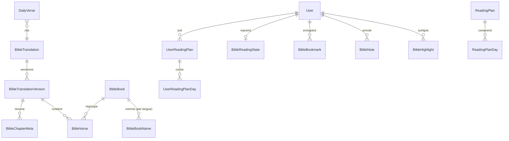

# Schéma de données Bible

## Diagramme



`BibleChapter` n'est pas une table : un chapitre = `(versionId, bookId, chapter)`. `BibleChapterMeta` dénormalise le
nombre de versets par chapitre (navigation, validation des références) — 1 189 lignes par version.

## Tables de référence (lecture seule pour le rôle applicatif)
```prisma
model BibleTranslation {
  id           Int     @id @default(autoincrement())
  code         String  @unique          // "lsg", "darby"
  name         String                   // "Louis Segond 1910"
  language     String                   // "fr"
  licenseType  BibleLicense             // PUBLIC_DOMAIN | CC_BY | CC_BY_SA | LICENSED
  licenseUrl   String
  attribution  String                   // texte affiché
  sourceUrl    String
  licenseEvidence String                // référence de l'archive de la page de licence
  isPublished  Boolean @default(false)
  activeVersionId Int?  @unique
}

model BibleTranslationVersion {
  id            Int      @id @default(autoincrement())
  translationId Int
  sourceProvider String                 // "ebible-usfx"
  sourceRetrievedAt DateTime
  checksum      String                  // SHA-256 global
  verseCount    Int
  importedById  String
  importedAt    DateTime @default(now())
  status        VersionStatus           // STAGED | ACTIVE | RETIRED
}

model BibleBook {
  id        String  @id                 // code USFM "JHN"
  order     Int     @unique             // 1..66
  testament Testament                   // OT | NT
  chapterCount Int
}

model BibleBookName {
  bookId String  language String
  name String                           // "Jean"
  abbreviations String[]                // ["jn", "jean", "jea"]
  @@id([bookId, language])
}

model BibleVerse {
  id        Int    @id @default(autoincrement())
  versionId Int    bookId String  chapter Int  verse Int
  text      String
  checksum  String                      // SHA-256 du texte
  // search  tsvector GENERATED ALWAYS AS (to_tsvector('french_unaccent', text)) STORED  (SQL brut)
  @@unique([versionId, bookId, chapter, verse])
  @@index([versionId, bookId, chapter])
}
```
SQL complémentaire (migration) :
```sql
REVOKE INSERT, UPDATE, DELETE ON bible_verse, bible_translation_version FROM eparole_app;
GRANT  INSERT ON bible_verse, bible_translation_version TO eparole_bible_import;
CREATE INDEX bible_verse_search_idx ON bible_verse USING GIN (search);
```

## Données utilisateur
```prisma
model BibleHighlight {
  id String @id @default(cuid(2))
  userId String  translationId Int  bookId String  chapter Int  verseStart Int  verseEnd Int
  color HighlightColor                  // YELLOW GREEN BLUE PINK PURPLE
  createdAt DateTime @default(now())
  @@index([userId, bookId, chapter])
}
model BibleNote {                       // strictement privée
  id String @id @default(cuid(2))
  userId String  translationId Int  bookId String  chapter Int  verseStart Int  verseEnd Int
  body String @db.VarChar(5000)
  createdAt DateTime @default(now())  updatedAt DateTime @updatedAt
  @@index([userId, bookId, chapter])
}
model BibleBookmark { id String @id @default(cuid(2))  userId String  translationId Int  bookId String  chapter Int  verseStart Int  verseEnd Int  label String?  @@unique([userId, translationId, bookId, chapter, verseStart, verseEnd]) }
model BibleReadingState { userId String @id  translationId Int  bookId String  chapter Int  fontScale Int @default(100)  lineHeight Float @default(1.7)  theme ReaderTheme @default(SYSTEM)  updatedAt DateTime @updatedAt }

model DailyVerse {
  id String @id @default(cuid(2))
  date DateTime @db.Date @unique        // un verset par jour (fuseau Africa/Ouagadougou = UTC)
  translationId Int  bookId String  chapter Int  verseStart Int  verseEnd Int
  reflection String?                    // courte phrase éditoriale, séparée du texte biblique
  status ContentStatus  scheduledById String  approvedById String?
}
```
Les données utilisateur référencent les versets par **coordonnées** (livre, chapitre, verset) et non par `BibleVerse.id`,
pour survivre à une réimport de version. Si la versification d'une nouvelle version diffère, un job de rapprochement
signale les références orphelines.

## Volumétrie
~31 000 versets par traduction (le compte exact de la source sera vérifié à l'import), ~5 Mo de texte, index GIN ~10 Mo.
Négligeable pour PostgreSQL.
