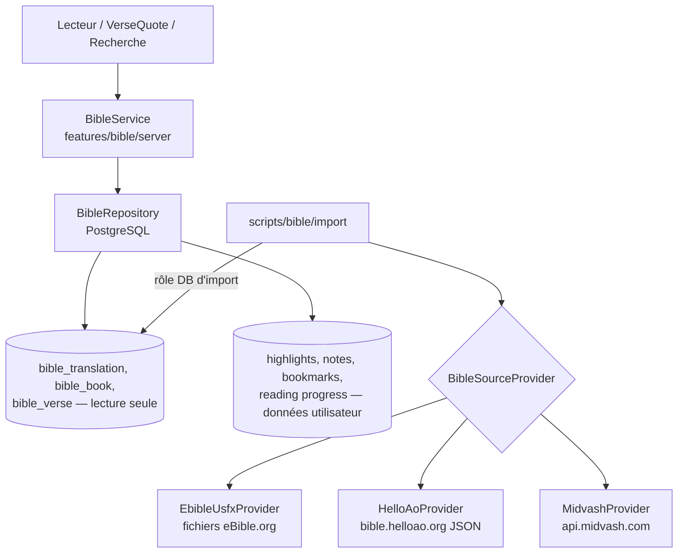

# Module Bible — conception

## Fonctionnalités et phases
| Fonction | Phase | Statut |
|---|---|---|
| Lecture LSG 1910 (66 livres) | 2 | Implémenté |
| Navigation livre / chapitre / verset, précédent / suivant | 2 | Implémenté |
| Recherche par référence et plein texte | 2 | Implémenté |
| Réglages (taille, interligne, thème, focus), reprise de lecture | 2 | Implémenté |
| Copier, surligner, noter, favori, partager par lien | 2 | Implémenté |
| Partager dans une publication (bouton « Publier » de la barre d'actions) | 3 | Implémenté |
| Partager dans une communauté | 4 | Prévu |
| Associer un passage à une prière | 4 | Prévu |
| Partager dans une conversation | 7 | Prévu |
| Verset du jour éditorialisé | 2 | Implémenté |
| Darby + comparaison de traductions | 6 | Prévu |
| Plans de lecture | 6 | Prévu |
| Méditations liées aux passages | 6 | Prévu |
| Hors connexion | 7 | Prévu |

## Architecture hybride



**Principe clé** : les fournisseurs externes servent à **importer** (et éventuellement vérifier) des textes ; ils ne sont
jamais appelés au moment d'afficher une page. Le lecteur lit uniquement PostgreSQL. Avantages : aucune dépendance de
disponibilité, latence faible, cache CDN possible, recherche FTS locale, coût nul. Cela n'est possible que pour des textes
dont la licence permet le stockage et la redistribution (domaine public ou licence libre) : voir [BIBLE-LICENSING.md](BIBLE-LICENSING.md).

Pour une future traduction sous droits accessible uniquement par API (ex. via API.Bible), un `RemoteBibleProvider`
avec cache conforme aux conditions du fournisseur pourra être ajouté **derrière la même interface de lecture**.

## Interfaces
```ts
// features/bible/types.ts
type TranslationCode = "lsg" | "darby";          // étendu par import
type BookId = "GEN" | "EXO" | /* … codes USFM … */ "REV";
interface VerseRef { translation: TranslationCode; book: BookId; chapter: number; verseStart: number; verseEnd?: number }

// Lecture (runtime)
interface BibleReader {
  getChapter(t: TranslationCode, book: BookId, chapter: number): Promise<Chapter | null>;
  getPassage(ref: VerseRef): Promise<Passage | null>;          // texte + attribution
  search(q: SearchQuery): Promise<SearchPage>;
  listBooks(t: TranslationCode): Promise<BookSummary[]>;
}

// Import (scripts uniquement)
interface BibleSourceProvider {
  id: "ebible-usfx" | "helloao" | "midvash";
  fetchTranslation(code: string): AsyncIterable<SourceVerse>;   // { book, chapter, verse, text }
  metadata(code: string): Promise<SourceMetadata>;              // licence, URL, version
}
```
Les codes de livres suivent **USFM** (`GEN`, `PSA`, `JHN`, `1CO`…), indépendants de la langue ; les noms et abréviations
français sont en base (`bible_book_name`).

## Import contrôlé
1. Téléchargement manuel du fichier source (eBible.org `fraLSG` USFX) par un `SUPER_ADMIN`, stocké hors dépôt (`data/bible-sources/`, ignoré par Git).
2. `pnpm bible:import --dry-run` : parse, normalise (encodage NFC et espaces ; apostrophes et ponctuation conservées telles quelles),
   calcule un SHA-256 par verset et global, compare au référentiel attendu (66 livres, 1 189 chapitres, nombre de versets de la source).
3. Rapport d'écarts (versets manquants, versification). Validation humaine.
4. Import réel en transaction dans une **nouvelle version** de traduction (`bible_translation_version`) ; activation
   atomique de la version ; l'ancienne reste disponible pour les références existantes.
5. Audit `bible.import.staged` puis `bible.version.activated` ; activation par `pnpm bible:activate` ou `/admin/bible/translations`.

Commandes réelles :
```bash
pnpm bible:import --source ebible --translation lsg --file <usfx> --retrieved-at AAAA-MM-JJ --license-evidence <archive> --dry-run
pnpm bible:crosscheck --file <usfx> --helloao <complete.json>   # lecture seule, écarts listés
pnpm bible:import ...                                           # sans --dry-run : version STAGED
pnpm bible:activate --translation lsg --publish                 # activation explicite
```

Aucune édition verset par verset n'est possible dans l'UI admin.

## Règles de citation
Toute citation (`VerseQuote`) stocke la référence (`VerseRef` + version de traduction) et **rend le texte depuis la base**.
Le texte n'est pas recopié dans la publication, ce qui garantit l'exactitude et empêche la modification par l'auteur.
L'attribution (« Louis Segond 1910 — domaine public ») est affichée à côté.
