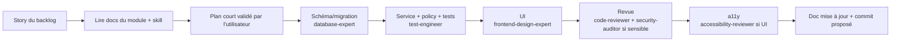

# Workflows Claude Code

## Nouvelle fonctionnalité

1. Partir d'un identifiant (`US-20`, `B-4`).
2. Charger le skill du module (`/eparole-prayers`) ; il pointe vers les documents à lire.
3. Écrire d'abord la policy et ses tests négatifs, puis le service, puis l'UI.
4. Lancer `pnpm lint && pnpm typecheck && pnpm test` ; E2E si parcours touché.
5. Demander une revue (`code-reviewer`) ; `security-auditor` obligatoire pour auth, policies, prières, messagerie, uploads.
6. Mettre à jour le statut « Implémenté » dans la doc du module.
7. Proposer le commit ; ne jamais pousser sans demande.

## Correction de bug
Reproduire par un test qui échoue → corriger → vérifier → ajouter le cas au test de régression.

## Ajout d'une traduction biblique
`/eparole-bible-licensing` → fiche de licence → validation humaine → `bible-integration-expert` (import `--dry-run`) →
rapport d'intégrité → validation → import → activation.

## Changement de permissions
Modifier d'abord [ADMIN-ROLES-PERMISSIONS](../admin/ADMIN-ROLES-PERMISSIONS.md), puis `permissions.ts`, puis les tests ;
revue `security-auditor`.

## Garde-fous
- Phase courante uniquement (`docs/08-ROADMAP.md`).
- Vérifier les API de librairies avec Context7 (une fois installé) plutôt que de mémoire.
- Ne pas installer de dépendance sans justification ; jamais de version préliminaire.
